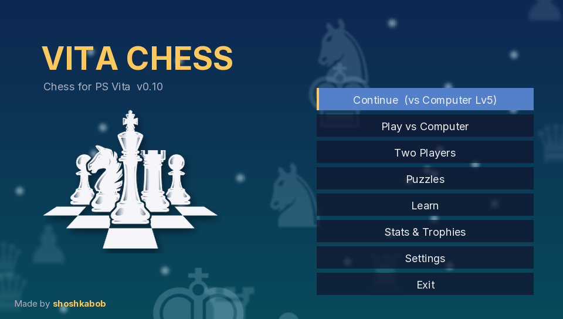
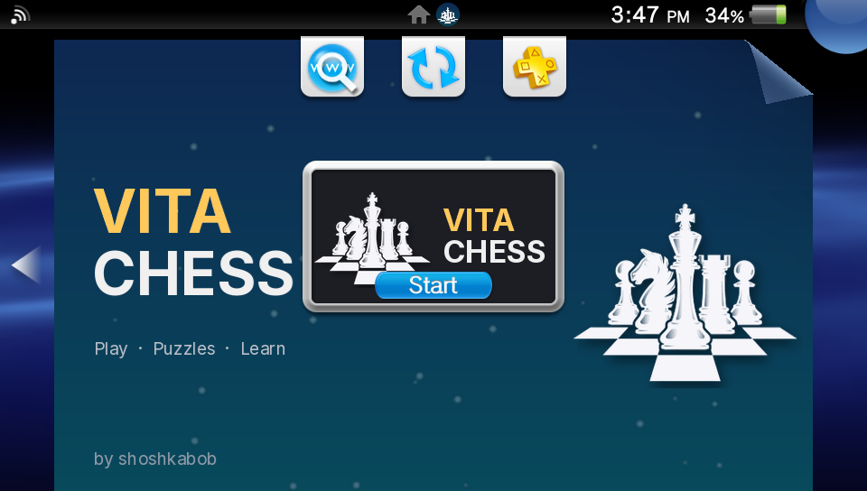
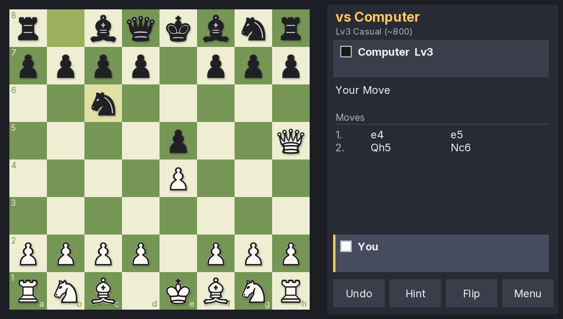
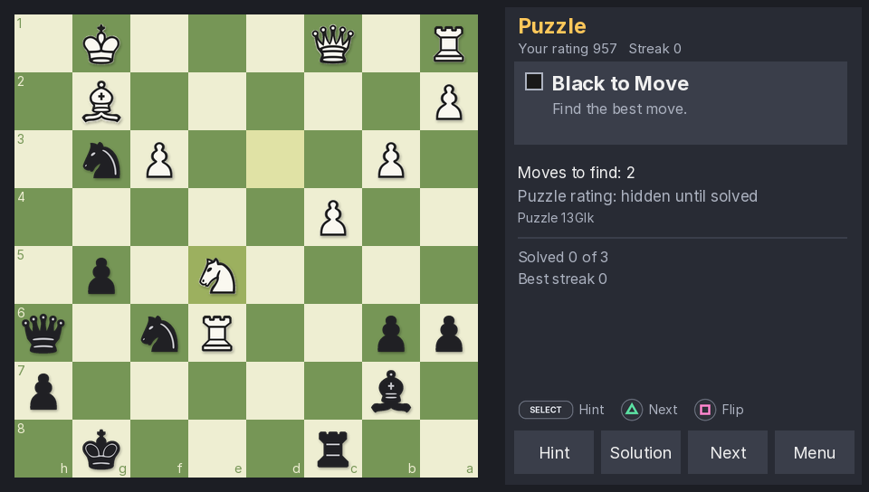
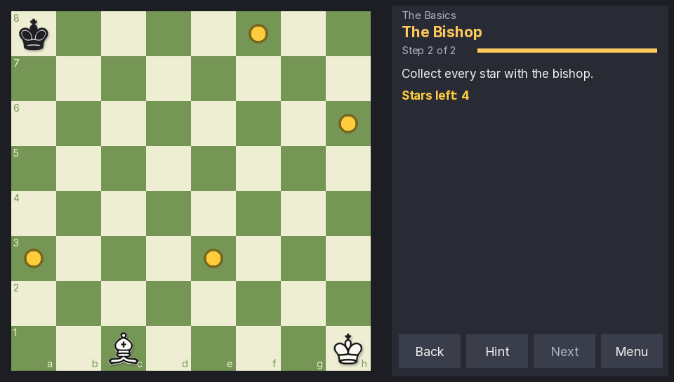
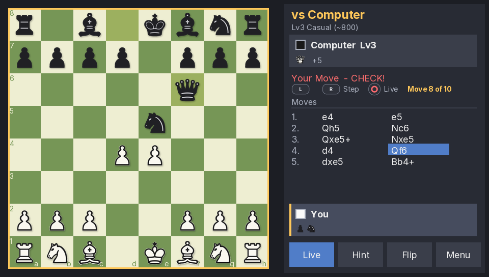
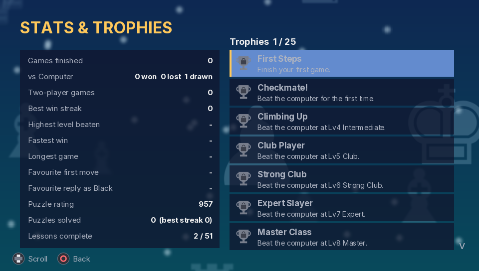
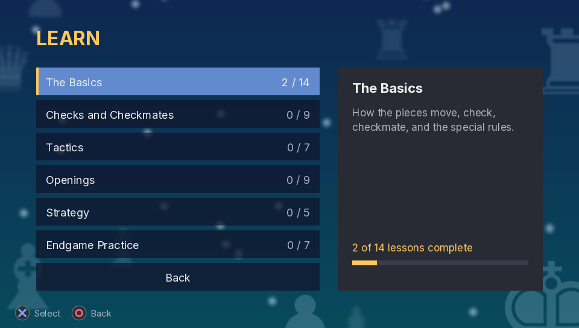
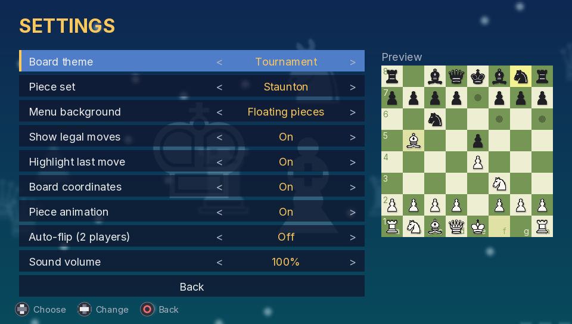

<p align="center">
  
</p>

<h1 align="center">Vita Chess</h1>

<p align="center">
  <b>A complete chess game for the PlayStation Vita.</b><br>
  Play the computer, solve puzzles, learn the game, and collect trophies.<br>
  Made by <b>shoshkabob</b>.
</p>

---

## Features

### Play
- **Play the computer at 8 difficulty levels**, from Beginner (~400) to Master (~1800). The Elo figures are rough guides.
- **Play as White, Black, or Random.** The computer opens with real openings from a built-in book (41 lines), so games don't start the same way twice.
- **Two-player pass-and-play** on one Vita, with optional auto-flip so the board always faces whoever's turn it is.
- **Chess clocks:** 3 min + 2, 5 min, 10 min, 15 min + 10, or 30 min. The computer manages its own time.
- **Hints** shown as arrows on the board, **undo**, **resign**, and **draw offers**.
- **Look back at any move:** scroll the move list and tap a move (or use L and R) to see that position.
- **Full rules:** castling, en passant, promotion, check, checkmate, stalemate, threefold repetition, the 50-move rule, and insufficient material.

### Puzzles
- **1,000 tactics puzzles** from the Lichess puzzle database, rated from 400 to 2900.
- **Your own puzzle rating**, with streaks and best streak. Adaptive mode picks puzzles near your level, or choose Easy, Medium, Hard, or Expert.
- Two-step hints, step-by-step solutions, and Try Again.

### Learn
**51 interactive lessons in 6 courses** (117 steps). Each mixes short explanations with positions where you make the moves yourself:

| Course | Lessons | What's in it |
|---|---|---|
| The Basics | 14 | The board, every piece, check, checkmate, stalemate, castling, en passant, promotion, draws |
| Checks and Checkmates | 9 | Discovered and double check, perpetual check, back-rank mate, smothered mate, the rook ladder, and more |
| Tactics | 7 | Forks, pins, skewers, discovered attacks, removing the defender, deflection |
| Openings | 9 | Opening principles, guided walkthroughs of the Italian, Ruy Lopez, Queen's Gambit, London, Sicilian, French, and Caro-Kann, plus opening traps |
| Strategy | 5 | Active pieces, open files, pawn structure, passed pawns, trading when ahead |
| Endgame Practice | 7 | King activity, the opposition, the rule of the square, and drills against the computer |

### Stats & Trophies
- Your record against each level, win streaks, fastest win, longest game, favourite openings, and puzzle and lesson progress.
- **25 trophies** to unlock, from your first win to beating Master level and finishing every lesson.

### Look and feel
- **Animated menu backgrounds:** Floating pieces, Waves, or Classic.
- **7 board themes** (Wood, Tournament, Ice Blue, Midnight, Lavender, Coral, Marble) and **5 piece sets** (Classic, Staunton, Flat, Neon, Pixel).
- Pieces slide into place, captured pieces fly to the side panel, and the king shakes when it's put in check.
- Sound effects with adjustable volume, and crisp text throughout.
- **Touch and buttons:** tap or drag pieces, or use the D-pad.

### Saving
- The game in progress saves after every move, so you can continue from the main menu.
- Finished games are saved as **PGN files** in `ux0:data/VitaChess/games/`, ready to analyse on Lichess or chess.com.

## Screenshots

<p align="center">
   <br>
   <br>
   <br>
   
</p>

## What's next

**Coming next**
- **Game review:** step through a finished game, with the computer flagging blunders and showing better moves.
- **Evaluation bar:** see who's winning at a glance, especially while reviewing a game.

**Ideas for later**
- **More lessons:** more openings, plus classic endgame techniques like the Lucena and Philidor positions.
- **Computer personalities and handicaps:** aggressive or defensive opponents, or the computer starting a piece down.
- **A stronger computer** at the top levels.
- **A PSP version:** an early test build already runs.
- **Two-Vita multiplayer** over local Wi-Fi (exploring).
- **Background music.**

Suggestions are welcome: open an issue.

## Installing

1. Download `VitaChess-<version>.vpk` from the [Releases](../../releases) page.
2. Copy it to your Vita and install it with VitaShell.

Requires a Vita or PS TV with homebrew enabled (HENkaku / Ensō).

## Controls

| Button | In a game | In puzzles and lessons |
|---|---|---|
| D-pad + Cross | Move the cursor, select or move a piece | Same |
| Touch | Tap a piece then a square, or drag it | Same |
| Circle | Cancel / return to the live game | Cancel |
| Triangle | Undo | Next puzzle / next step |
| Square | Flip the board | Flip the board |
| SELECT | Hint | Hint |
| START | Pause menu | Pause menu |
| L / R | Step back and forward through the moves | |

## For developers

The game is written in Lua and runs on [Lua Player Plus Vita](https://github.com/Rinnegatamante/lpp-vita). The chess engine and computer player are written from scratch: alpha-beta search with iterative deepening, quiescence search, and an opening book.

### Building

Requires Python 3 (standard library only). From the repository root:

```
python tools/build.py
```

This writes `dist/VitaChess-<version>.vpk` and `dist/index.lua`. The first build downloads the Lua Player Plus Vita `eboot.bin` and caches it in `tools/cache/`.

| Option | What it does |
|---|---|
| `--test` | Runs the test suite (needs [LuaJIT](https://luajit.org/)) |
| `--desktop` | Builds a desktop preview you can run with [LOVE 11](https://love2d.org) (mouse = touchscreen) |
| `--deploy <Vita IP>` | Sends `index.lua` to the Vita over FTP (VitaShell's FTP server or the vitacompanion plugin) |
| `--psp` | Builds an experimental PSP version for the LuaDEV R0 interpreter |

Art, fonts, and sounds are generated by scripts in `tools/` (`make_art.py`, `make_fonts.py`, `make_pieces.py`, `make_sounds.py`). The results are committed in `assets/`, so you only need them to change the artwork.

### Tests

`python tools/build.py --test` checks the move generator against published perft counts, every rule, every puzzle and lesson answer, and the computer player. It then plays through the menus, games, puzzles, and lessons on a simulated Vita.

### How the code is organised

| File | What it does |
|---|---|
| `src/chess.lua` | The rules: board, legal moves, check/mate/draws, notation |
| `src/ai.lua` | The computer player and difficulty levels |
| `src/book.lua` | Opening book |
| `src/puzzles.lua` | Puzzle collection, rating, and progress |
| `src/lessons.lua`, `src/learn.lua` | Learn course content, and the code that runs lessons |
| `src/stats.lua`, `src/trophies.lua` | Records and the 25 trophies |
| `src/pgn.lua` | PGN export |
| `src/ui.lua`, `src/app.lua` | Drawing helpers, menus, screens, and game flow |
| `src/platform.lua` | The only file that calls Lua Player Plus Vita |
| `src/platform_love.lua`, `src/platform_psp.lua` | Desktop and PSP versions of the platform layer |

## Credits

See [CREDITS.md](CREDITS.md). Puzzles come from the [Lichess puzzle database](https://database.lichess.org/#puzzles) (CC0). Interface font: [Inter](https://rsms.me/inter/) (SIL OFL). Runs on Lua Player Plus Vita by Rinnegatamante.

## License

GPLv3 (see [LICENSE](LICENSE)), matching Lua Player Plus Vita, whose eboot is included in the VPK.
